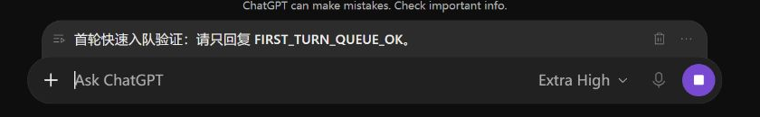
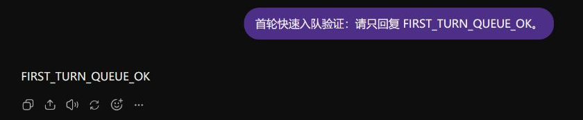

# ChatGPT Web Queue

Chrome 的 ChatGPT 消息队列与对话命名扩展。队列托盘内缩在原输入框上方，支持当前回答完成后逐条自动发送；对话名称可根据首条消息或整段对话，按项目、日期、活动与标签自动生成。两项功能独立开关。

## 使用效果

在 ChatGPT 真实页面中，回答进行时输入的后续消息会显示在原输入框上方的队列托盘。



上一轮回答完成后，队列消息自动发送；收到回复后，空队列托盘隐藏。



## 安装

1. 按下文从源码构建，使用生成的 `dist` 目录，或解压本地打包生成的 `release/chatgpt-web-queue-v0.4.0.zip`。
2. 在 Chrome 打开 `chrome://extensions`，开启右上角的「开发者模式」。
3. 点击「加载已解压的扩展程序」，选择**包含 manifest.json 的目录**。
4. 刷新已打开的 ChatGPT 页面。点击 Chrome 工具栏的拼图图标，将 ChatGPT Web Queue 固定到工具栏，便于打开设置。更新已有安装时，在扩展管理页点击本扩展的「重新加载」，再刷新 ChatGPT。

## 使用

- Queue **默认开启**。点击 Chrome 工具栏的扩展图标，在弹窗里开启／关闭。网页内只显示队列，不显示开关。开关状态会保存在本机，并在所有 ChatGPT 标签页同步。
- 关闭后，已有队列保留，扩展停止拦截 Enter 和自动发送。再次开启后继续处理尚未暂停的队列；手动暂停的队列仍需要点击「继续」。
- 当前回复**尚未完成**时，在原输入框写好下一条消息，按 **Enter** 或点击网页发送按钮即可加入队列。等待回复、生成中，以及没有停止按钮但仍标记未完成的回复都可以排队。每次操作加入一条消息，段落和代码换行保留；相同内容可以重复排队。
- **Shift+Enter** 换行。中文输入法正在选词时，Enter 不会触发入队。
- 回复已完成且没有队列时，Enter 和发送按钮保持网页原有行为。已有待发送消息时，新消息追加到队尾。自动发送仍需要页面明确显示本轮回答完成。
- 队列默认单行展示，点击消息展开全文；右侧垃圾桶移除消息，「⋯」菜单提供编辑、排序、折叠和暂停。左侧图标支持拖动排序，聚焦后可用方向键调整位置。
- 在「⋯」菜单中点击「暂停自动发送」暂缓后续发送；点击「继续」恢复。移除的消息可以通过「撤销」或菜单中的恢复操作找回。
- 自动发送前若输入框已有新草稿，会等待输入框空闲。先处理或清空草稿，队列才会继续。
- 消息使用**发送时网页当前选择的模型**；扩展不自动切换模型。

## 保存与恢复

队列按会话分别保存在 `chrome.storage.local`。同一会话只有一个标签页负责发送，其他标签页可以添加消息，或通过「在此标签页接管」切换发送权。

刷新、关闭标签页或离开当前会话会保留队列。返回会话后，核对状态并点击「继续」。网络错误、网页错误和手动停止回答也会暂停队列。

扩展以新用户消息出现在会话中作为发送确认。刷新或连接中断导致结果无法确认时，该条消息保留为「发送结果待确认」，需要选择「已发送」或「尚未发送」后继续。

自动发送依赖已打开的 ChatGPT 页面。标签页冻结、浏览器退出或电脑休眠期间不会继续操作页面。

## 自动命名

点击工具栏的扩展图标，进入「命名规则与模型设置」，填写 API 基础地址、模型名称和凭据后保存。支持 OpenAI 兼容 Chat Completions、OpenAI Responses，以及本机的兼容模型服务。模型名称由用户填写；默认使用首条消息模式。首次配置时，Chrome 会请求所填模型服务域名的访问权限。

- **首条消息**：只将真正的首条用户消息发送给命名模型，概括任务意图。第一轮回复完成后命名，后续回复不会重复调用模型；可手动重新生成。读取已有长对话时，可能需要先加载更多历史以定位首条消息。
- **整段对话总结**：使用当前分支的用户和 AI 正文，随讨论更新名称。长文本会分段归纳；不解析图片与附件正文。历史未完整取得时，会显示错误并保留原名称。
- 自动命名等待回复完成、输入草稿空闲，以及当前未暂停的消息队列处理完毕。同一会话多个标签页共用任务协调；切换会话、继续聊天或修改规则后，过期结果不会自动写入。

默认格式：

| 场景 | 模板 | 示例 |
| --- | --- | --- |
| 项目内对话 | `{项目简称} \| {日期} \| {活动}` | `比赛 \| 10-19 \| 资料收集` |
| 非项目对话 | `{日期} \| {活动}` | `10-19 \| 登录问题修复` |

日期使用对话创建时间，可设置时区及月日 / 年月日格式。项目简称按项目名称精确匹配，也支持绑定项目 ID。项目规则可覆盖全局模式、命名要求和模板；从 ChatGPT 页面的扩展弹窗进入设置，还可为当前对话单独配置模式、要求及固定标签。

模板支持 `{项目简称}`、`{项目名称}`、`{日期}`、`{活动}`、`{主题}`、`{标签}`。固定标签可在全局、项目和当前对话叠加；条件标签例如「讨论论文检索或文献整理 → 调研」，由模型依据所选内容判断。只有模板包含 `{标签}` 时才显示标签，例如：

```text
比赛 | 10-19 | 无人机方案调研 #竞赛 #调研
```

设置页可用示例文字预览模型结果与最终标题。工具栏提供「重新生成」「锁定标题」「撤销改名」；最近 10 次改名保留原名称。手动改名后自动锁定；撤销改名后也会锁定，可手动解除。网页菜单和会话数据结构发生变化时，可能需要更新适配器。

命名会将所选内容、命名要求和条件标签发送给用户配置的模型服务；凭据保存在本机，网页会话凭据仅用于同站读取，不发送给命名模型。插件保存命名配置、标题记录和任务指纹，完整对话正文不另存到扩展存储。关闭自动命名后，消息队列仍可独立使用。

## 支持范围与权限

- 桌面 Chrome 120+，`https://chatgpt.com`，普通聊天和 Thinking。
- 纯文本队列；输入框有附件时，保留草稿并提示先移除附件。
- 支持当前网页 DOM 与常见旧版消息结构。ChatGPT 改版后可能需要更新网页适配器。
- 权限为 `storage` 和 `activeTab`，Content Script 仅在 `chatgpt.com` 上运行；命名模型服务的域名权限按配置单独申请。
- 队列文本存储在本机，派发时通过 ChatGPT 网页的正常发送流程提交；命名功能按设置调用模型服务。
- 没有 Steer、模型切换、云同步或附件队列。

## 从源码构建

需要 Node.js 24+。

```powershell
npm ci
npm run check
npm run build
npm run package
```

打包命令需要 Windows PowerShell；仅加载扩展时，完成构建后选择 `dist` 目录即可。

源码入口：

- `src/core/`：队列状态、回合与发送状态转换。
- `src/page/adapter.ts`：编辑器、消息、生成和结束状态适配。
- `src/controller.ts`：键盘入队、草稿保护、自动派发和发送确认。
- `src/background.ts`：持久存储和单标签页发送协调。
- `src/naming/`：命名规则、模型请求、标题历史与跨标签页任务协调。
- `src/page/naming-bridge.ts`、`src/page/title.ts`：会话读取和原生重命名操作。
- `src/options.ts`：命名规则与模型设置。
- `src/ui/`：Shadow DOM 队列托盘。

依赖、npm 缓存、构建和 ZIP 都位于项目目录。

队列界面使用 Phosphor Icons 的 Light 图标。其 MIT 许可随扩展附在 `PHOSPHOR-LICENSE.txt` 中。
